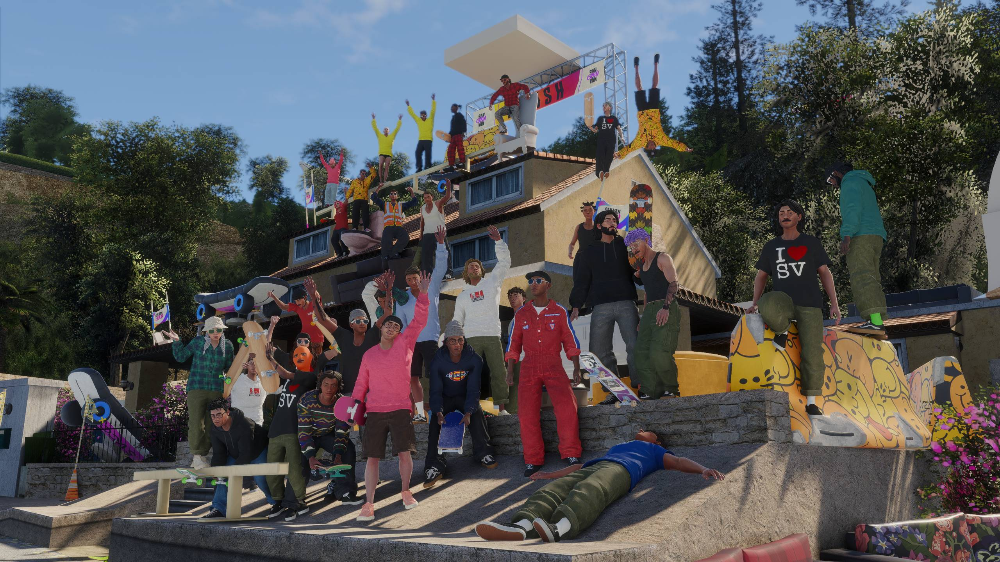

<p align="center"></p>
<h1 align="center">ReSkate PS5</h1>
<p align="center"><strong>An experimental ReSkate launcher for a jailbroken PlayStation 5.</strong><br>Wine · vkd3d-proton · RADV · bring your own game</p>
<p align="center"><a href="https://wwwshelton19-spec.github.io/ReSkate-PS5/">Project website</a> · <a href="https://github.com/wwwshelton19-spec/ReSkate-PS5/releases/tag/v0.1.0-experimental">Experimental release</a> · <a href="docs/INSTALL.md">Installation guide</a> · <a href="docs/STATUS.md">Test results & limitations</a></p>



> **This is a development preview, not a playable release.** The home-screen title and official blue RE artwork work. ReSkate reaches its splash/loading screen and compiles shaders. **A controllable skater, stable gameplay, and multiplayer have not been verified.** Shader stalls, application exits, and a console crash occurred during testing. The latest user report confirms it passed shader compilation, then crashed with **CE-108255-1**. Logs reached `Level active` and `Local player joined`, but controllable gameplay remains unverified. Do not download expecting a finished port.

## What this project does

This integration starts the Windows version of ReSkate inside one PS5 homebrew title. A Wine bootstrap initializes `ReSkate.dll` before the unmodified `Skate.exe` entrypoint. vkd3d-proton translates Direct3D 12 to Vulkan, and the PS5 RADV port drives the GPU. The console does not boot Linux or start a desktop session.

The project builds on [WoWPS5](https://github.com/BeLikeBrett/WoWPS5) and [ReSkate](https://github.com/Dingo-Shenanigans/ReSkate). It has its own title ID, `PPSA99223`, and its own `/data/reskate` runtime. The visible name is **ReSkate**, with the official upstream icon and artwork.

The release contains the experimental title, patched Wine DLLs, a minidump forwarding shim, configuration, and notices. It contains **no skate. game files, PC content cache, account data, Microsoft compiler DLL, firmware, or keys**. The Wine base runtime is supplied separately from its pinned upstream release.

## Who should try it

This preview is for homebrew testers who can recover from an application or console crash and want to help diagnose the remaining shader/loading failure. The installer has local validation and automated tests; **a clean installation on a second console has not been demonstrated**. Compatibility with every firmware, jailbreak, or PS5 model is unknown.

You need:

- A jailbroken PS5 with a homebrew enabler, FTP, and a manager that can register `/data/homebrew` apps, such as ShadowMount.
- A PC with **Python 3.11 or newer**, on the same trusted LAN as the PS5.
- Your own compatible skate. game files: **Steam build 25414733**, prepared by **ReSkate 2.0.5**. The installer checks exact input hashes; newer versions are not assumed compatible.
- Your own ReSkate PC cache for that build. Launch the compatible PC version and let content preparation finish first.
- The pinned WoWPS5 **v0.1.0** base ZIP, the ReSkate PS5 bundle, and your own matching Windows SDK x64 `d3dcompiler_47.dll`.
- At least **20 GiB free** on the PS5; allow more for shader caches. The tested game files alone occupy about 13 GiB. The installer does not query free space.

## Installation overview

1. Read the [full installation guide](docs/INSTALL.md), including the known failures.
2. Download this repository and the matching experimental bundle from the release. Extract the bundle into `bundle/` beside `install.py`.
3. Supply the required local inputs and run `install.py` without `--install`. This checks every selected file and makes **no console connection**.
4. Once validation passes, fully close ReSkate and return the PS5 to its home screen. Repeat with `--host YOUR_PS5_IP --install --console-at-home`.
5. Register `/data/homebrew/PPSA99223` using your homebrew manager, then launch **ReSkate**.

Example (PowerShell; replace every path and the example address):

```powershell
python install.py --base "D:\Downloads\WoWForever-PS5.zip" --game "D:\Games\ReSkate" --cache "$env:LOCALAPPDATA\ReSkate\cache\25414733" --compiler "C:\Program Files (x86)\Windows Kits\10\Redist\D3D\x64\d3dcompiler_47.dll"
```

Add `--host 192.168.1.50 --install --console-at-home` to that same command only when ready to copy. The IP is an example, not a default.

The installer reads back each uploaded file and checks SHA-256 before renaming it into place. On a retry, it skips files only after reading and hashing their remote contents. Interrupted files restart from the beginning. This uses more network traffic than size-only copying, but detects same-size corruption. Unrecognized existing installations are rejected; [see upgrade notes](docs/INSTALL.md#existing-installations).

## What has been tested

- Windows image loading, file access, and threads inside the title.
- Direct3D 12 device creation, clear/present, and GPU fence completion.
- Frame-latency waitable objects and cross-queue synchronization, with both default queues and `single_queue`.
- XInput controller 0 detection in a diagnostic program.
- ReSkate initialization and visible loading/shader compilation.
- The official RE icon, confirmed on the PS5 home screen.

These checks do **not** establish gameplay performance, working game controls, audio, saves, online services, or multiplayer. See the [test ledger](docs/STATUS.md) for the distinction between observed results and outstanding work.

## Shader compilation

Two caches are involved: vkd3d-proton's cache beside the game, and RADV's native cache under the title directory. Both were observed growing. Preserve them across launches. A cache write proves work occurred; it does not prove the game will finish loading.

Some early diagnostic runs deliberately ended at a configured deadline. The normal configuration has **no forced timeout** (`WOWPS5_DEADLINE=0`). The later test passed shaders and reached level activation, then failed with CE-108255-1. There is no verified setting that eliminates the remaining failure, and no promised first-launch time. See [troubleshooting](docs/TROUBLESHOOTING.md).

## Source, licensing, and contributing

The release provides a corresponding-source archive for the modified native title and Wine integration, with component revisions and build notes. A clean build from a fresh machine is **not yet verified**; the tested executable was built from a prepared Linux toolchain. See [BUILD.md](docs/BUILD.md).

The linked native title is GPL-3.0-or-later as a whole. Individual components retain their licenses; Wine changes remain LGPL-2.1-or-later, and the new installer is MIT. Official ReSkate artwork is credited to its upstream repository. See [CREDITS.md](docs/CREDITS.md) and the release notices.

Useful contributions include a minimal shader compilation reproducer, a confirmed fresh installation, and evidence of reaching controllable gameplay. Open a [test report](https://github.com/wwwshelton19-spec/ReSkate-PS5/issues/new/choose) with sanitized details. Never upload game files, saves, your prefix, console databases, or unredacted logs.

Unofficial community project. Not affiliated with or endorsed by Dingo-Shenanigans, Electronic Arts, Full Circle, or Sony Interactive Entertainment. ReSkate, skate., PlayStation, and PS5 names and artwork belong to their respective owners.
